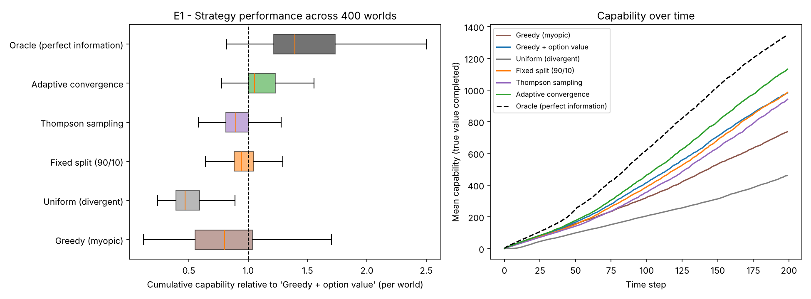
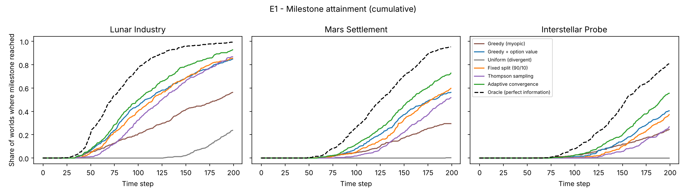
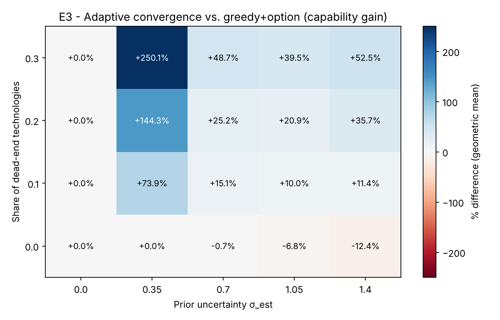
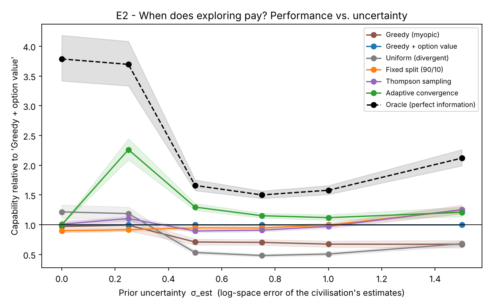
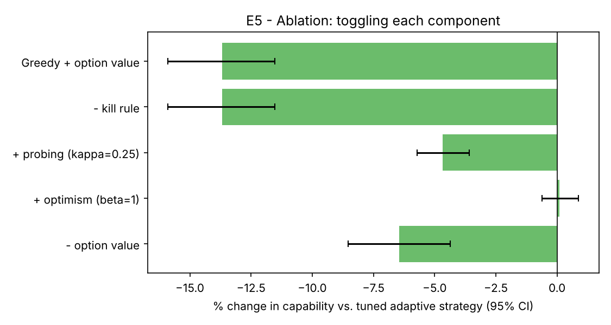
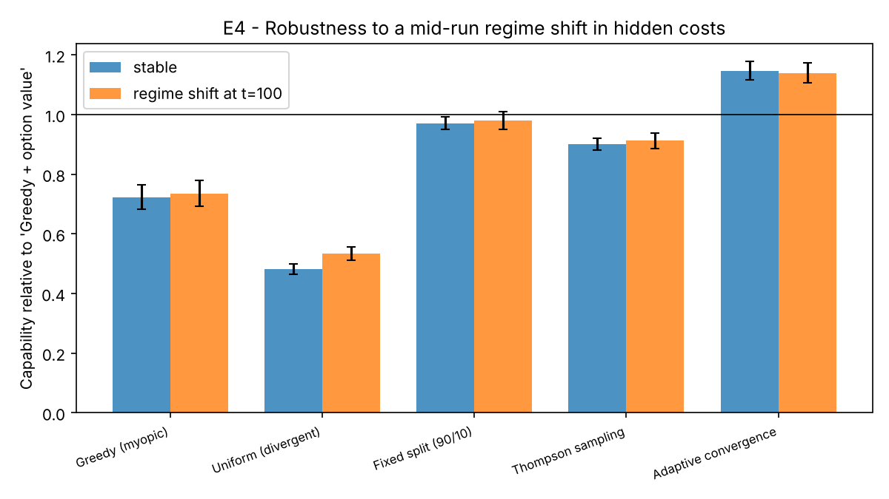
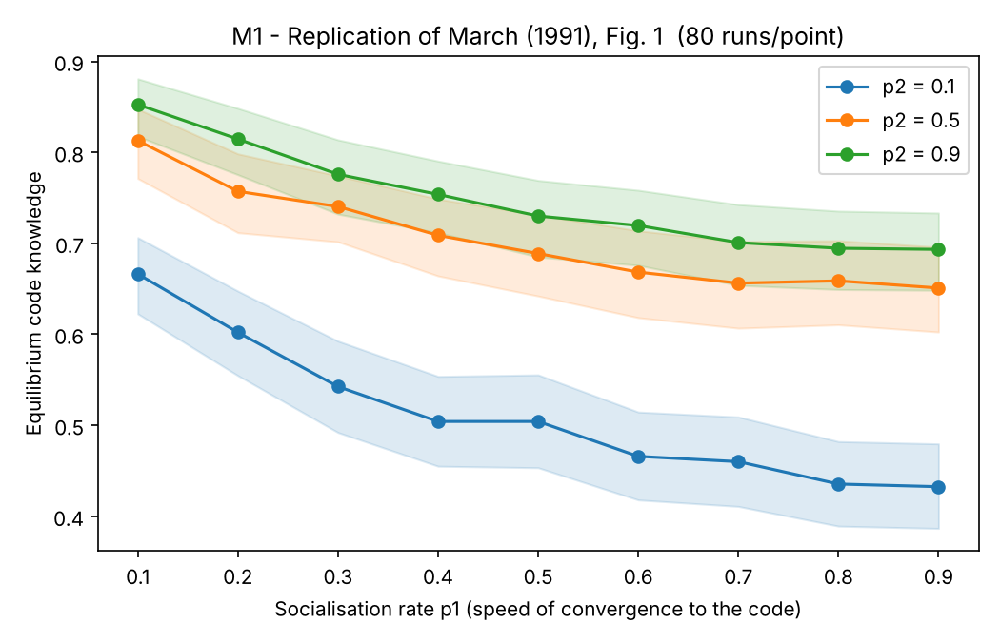
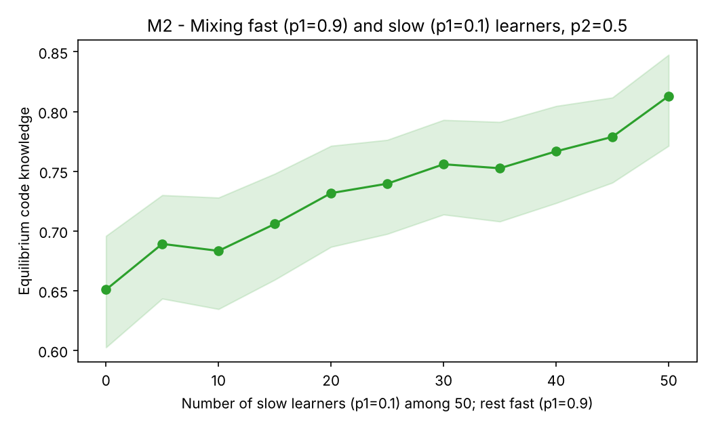

# Adaptive Convergence

**When should a technological civilisation stop converging on its best plan?**
An agent-based simulation of long-horizon research strategy, plus a replication of a classic model of exploration vs. exploitation.

A simulated civilisation must allocate a growing research budget across a procedurally generated technology graph (energy → manufacturing → lunar industry → Mars → interstellar probe). Costs are uncertain, some technologies are hidden dead ends, and completing "enabler" technologies grows the budget itself. Six allocation strategies are compared on hundreds of matched worlds against a perfect-information oracle.

## Key findings

All results are on **held-out evaluation worlds** (seeds ≥ 10 000); hyperparameters were tuned only on seeds 0–99.

1. **Converge, but stop on evidence.** The best strategy commits fully to the highest-value option (counting what it unlocks) and abandons any line of work once the posterior is confident it will cost more than 2× its estimate. Against the best purely convergent strategy it delivered **+15.8% cumulative capability** (95% CI 13.0–18.9%, Holm-adjusted *p* = 7 × 10⁻³⁷, better in 75% of 400 worlds). It reached the **interstellar milestone in 56% of worlds vs. 41%**, and lost **8.9% of budget to dead ends vs. 21.2%**.
2. **More exploration did not help.** Thompson sampling (−9.4%), a fixed 90/10 explore split (−2.6%), and spreading the budget evenly (−51%) all *underperformed* plain greedy allocation. In the ablation, adding probing to the tuned strategy cost 4.7%, and adding optimism had no effect.
3. **The gain exists only when reality contains failures outside the model.** In worlds with no dead ends, evidence-based stopping is neutral to harmful (down to −12% at high uncertainty, from false alarms). As dead ends become more common the advantage grows, up to +250%.
4. **Overconfidence is the trap.** When the civilisation believes its estimates are near-exact (σ ≈ 0), no strategy can recognise a dead end. Beliefs barely move, and even the oracle is 3.8× ahead. Evidence-based stopping needs priors humble enough to be overturned.
5. **Regime shifts: a null result.** Re-randomising hidden costs halfway through left the advantage unchanged (+14.6% stable vs. +13.8% shifted). Adaptivity did not confer *extra* robustness here.

The tuned strategy is therefore best described as **convergent commitment plus disciplined termination**, not "diverge more". That is a narrower claim than the essay that motivated this project, and the one the evidence supports.

| Strategy (400 worlds) | Capability vs. baseline | Lunar / Mars / Interstellar reached | Budget lost to dead ends |
|---|---|---|---|
| Greedy, myopic | 0.72× | 56% / 29% / 24% | 37.0% |
| **Greedy + option value** (baseline) | 1.00× | 85% / 56% / 41% | 21.2% |
| Uniform (pure divergence) | 0.49× | 24% / 0% / 0% | 30.9% |
| Fixed split (90/10) | 0.97× | 85% / 60% / 37% | 17.7% |
| Thompson sampling | 0.91× | 87% / 52% / 27% | 18.5% |
| **Adaptive convergence** (tuned) | **1.16×** | **93% / 73% / 56%** | **8.9%** |
| Oracle (perfect information, reference) | 1.44× (ratio of means) | 99% / 95% / 81% | 2.9% |








## The model

**World** (`src/acsim/world.py`): 8 layers × 8 technologies. Each technology is reachable by one or two alternative *routes* (sets of prerequisites), modelling competing architectures. Costs are log-normal and grow with depth. 12% of technologies are dead ends costing 25× more, and they look ordinary in the prior. 20% are *enablers* that permanently raise the research budget (recursive capability). Three milestones (lunar industry, Mars settlement, interstellar probe) are always truly reachable. The civilisation's estimates of cost and value carry log-normal noise σ_est, and 15% of technologies are systematically *underrated* (value × 0.25), standing in for unconventional ideas.

**Dynamics** (`src/acsim/sim.py`): each of 200 steps, the budget (10 × (1 + Σ enabler multipliers)) is split across available technologies. Spending makes progress and yields a noisy observation of true log-cost, updating a conjugate Gaussian belief. Expected remaining cost is computed from the belief *truncated at money already spent*: an unfinished project that has consumed its estimate is evidence it costs more. Strategies receive only an `Observation` object. Tests verify they cannot see ground truth, overspend, or fund locked technologies.

**Strategies** (`src/acsim/strategies.py`):

| Strategy | Idea |
|---|---|
| Greedy (myopic) | All budget to the best immediate value / expected remaining cost |
| Greedy + option value | Same, but value includes discounted value of everything a technology unlocks |
| Uniform (divergent) | Budget split evenly over all available technologies |
| Fixed split | (1 − f) to the best option, f spread over the rest (f tuned) |
| Thompson sampling | Rank by a cost sampled from the posterior (standard bandit baseline) |
| Adaptive convergence | Option value + optional optimism (β) + optional probing of runners-up (κ) + **kill rule**: drop a technology when μ − 2σ > log(k × prior estimate) |
| Oracle | Greedy + option value using the true hidden costs (an upper reference, not a competitor) |

Tuning (60 adaptive configurations, 4 fixed splits, 100 tuning worlds) selected β = 0, κ = 0, k = 2. In other words, it switched off the exploratory components.

## Methodology

- **Separate tuning and evaluation seeds**, so reported numbers are not overfit.
- **Paired design**: every strategy faces the same worlds. Comparisons use per-world log-ratios of cumulative capability (area under the capability curve), with 10 000-sample bootstrap CIs, two-sided Wilcoxon signed-rank tests, and Holm–Bonferroni correction.
- **Sanity checks**: removing the kill rule from the tuned strategy reproduces the baseline exactly (identical numbers), as it should. With exploration switched off, adaptive and greedy produce identical trajectories (unit test).
- **A bug I found and fixed**: an early version ignored the information in money already spent, so an overrunning project looked "almost done". That unfairly penalised greedy strategies. All results above use the corrected, Monte-Carlo-verified truncated belief.

## Replication: March (1991)

`src/acsim/march1991.py` re-implements the organisational-learning model from J. G. March, *Exploration and Exploitation in Organizational Learning*, Organization Science 2(1), 1991. There are 50 individuals and a 30-dimension reality. Individuals socialise toward an organisational code at rate *p1*, and the code learns from individuals who know more than it does at rate *p2*.

Reproduced qualitatively, 80 runs per point: **faster socialisation lowers equilibrium knowledge**, and **faster code learning raises it**. With p2 = 0.5, knowledge falls from 0.81 (p1 = 0.1) to 0.65 (p1 = 0.9). In a mixed population (p1 = 0.9 or 0.1), knowledge rose steadily with the number of slow learners, from 0.65 to 0.81, with no interior optimum. Ambiguities in the paper's verbal description are documented in the module docstring.




## Limitations

- A stylised model: the parameters are illustrative, not calibrated to real programmes. The conclusions are about *mechanisms* and *regimes*, not forecasts.
- Dead ends are the only out-of-model failure. Their 25× cost factor and 12% base rate drive the size of the effect (see E3).
- The selected kill threshold (2×) sits at the edge of the tuning grid. Stricter thresholds were not tested.
- Value estimates update only on completion. There is no information leakage between related technologies.

## Reproduce

Requires Python 3.10+. One command regenerates every number and figure (~8 min on 4 cores).

**Windows PowerShell**
```powershell
git clone https://github.com/cloudynirvana/adaptive-convergence.git
cd adaptive-convergence
python -m venv .venv
.\.venv\Scripts\Activate.ps1
pip install -r requirements.txt
python -m pytest -q                                # 21 tests
python experiments\run_experiments.py --quick      # ~30 s smoke run
python experiments\run_experiments.py              # full results
```

**macOS / Linux**
```bash
git clone https://github.com/cloudynirvana/adaptive-convergence.git && cd adaptive-convergence
python3 -m venv .venv && source .venv/bin/activate
pip install -r requirements.txt
pytest -q && python experiments/run_experiments.py
```

Outputs: `results/*.json` (every statistic quoted above) and `figures/*.png`. Use `--only e1 e3` to run a subset.

```
src/acsim/world.py        technology-graph generator (hidden truth + noisy priors)
src/acsim/sim.py          simulation engine, Bayesian belief updates, Observation API
src/acsim/strategies.py   allocation strategies and oracle
src/acsim/stats.py        bootstrap CIs, Wilcoxon, Holm correction
src/acsim/march1991.py    March (1991) replication
experiments/              experiment pipeline (tune, E1-E5, M1-M2)
tests/                    unit tests
```

## References

- March, J. G. (1991). Exploration and exploitation in organizational learning. *Organization Science*, 2(1), 71–87.
- Thompson, W. R. (1933). On the likelihood that one unknown probability exceeds another in view of the evidence of two samples. *Biometrika*, 25(3/4), 285–294.
- Holm, S. (1979). A simple sequentially rejective multiple test procedure. *Scandinavian Journal of Statistics*, 6(2), 65–70.
